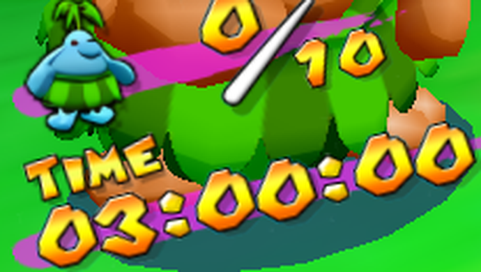

# Super Mario Sunshine HD texture extras

HD versions of Super Mario Sunshine textures that the [Super Mario Sunshine UHD Texture Pack](https://github.com/qashto/Super_Mario_Sunshine_UHD_Texture_Pack) (v2.1.1, by qashto and razius) does not cover.
They are meant to sit next to that pack, not to replace it.

They are made for the [Super Mario Sunshine PC port](https://github.com/chasem-dev/sms-pc-port), whose `tools/mods/get.py textures` (and SMS Launcher's **HD textures** setting) installs them together with the UHD pack.
They use Dolphin's custom texture format, so they also work in Dolphin.

## What is in it

208 textures, listed in [`TEXTURES.tsv`](TEXTURES.tsv):

- **Menus and HUD** (`textures/GMS/gui/`, 8×): the boot screen's NINTENDO GAMECUBE logo and "M" mark, GAME OVER, the ending's "THE END" and "Have a relaxing vacation!", the pause menu's guide pictures and maps, the Pianta and balloon counter icons, Yoshi's FRUIT gauge, the FLUDD gauge's TANK, message window corners, the file select's Pianta and sunglasses, the episode select's Corona Mountain banner, PUSH START.
- **Stages and characters** (`textures/GMS/models/`, 4×): textures the UHD pack left out, among them Pianta Village's walls and trees, the Delfino ship, Pinna Park's merry-go-round, pirate ship and Ferris wheel, the Monte Drink bottle, the FLUDD nozzle box, Princess Peach's face, hair and parasol, Petey Piranha, Gooper Blooper's arena, the secret levels' blocks and boards, doors, eggs, flags and birds.

`previews/<archive>.png` shows each one before and after.
The Pianta counter in the PC port:



[`MISSING.csv`](MISSING.csv) lists the 493 textures the game loads from its files that neither pack replaces yet.
Most are greyscale effects (glows, masks, ripples) that look much the same in HD, unused leftovers (a test font, Japanese menu text, a test stage), or textures the game rewrites while running, which no pack can match from the disc's data.
The end of `TEXTURES.tsv` lists the textures left out after review because the upscale looked worse than the original.

## Installing

- **PC port:** `python3 tools/mods/get.py textures` installs both packs; `python3 tools/mods/get.py extras` installs or updates only this one.
- **Dolphin:** unpack the release zip into Dolphin's `Load/Textures/` folder (it holds `GMS/...`) next to the UHD pack, and turn on **Load Custom Textures**.

## Making the textures yourself

Everything here can be rebuilt from your own North American disc (an ISO/GCM, or its extracted `files/` folder) with Python 3, Pillow (`pip install -r requirements.txt`) and a GPU with Vulkan:

```sh
python3 tools/get_realesrgan.py                  # once: Real-ESRGAN into tools/realesrgan/ (checked download)
python3 tools/make_textures.py "Sunshine.iso"    # every texture in TEXTURES.tsv, into textures/GMS/, and previews/
python3 tools/package.py                         # dist/sms-hd-texture-extras-<VERSION>.zip
```

`make_textures.py` reads each texture straight from the disc (`tools/gcdisc.py` reads the disc, its Yaz0/RARC archives, models and texture headers, and names textures the way the PC port and Dolphin look them up; `tools/decode.py` decodes GameCube texture formats).
It upscales with [Real-ESRGAN](https://github.com/xinntao/Real-ESRGAN)'s `realesrgan-x4plus-anime` model (the official [v0.2.5.0 release](https://github.com/xinntao/Real-ESRGAN/releases/tag/v0.2.5.0)), at the UHD pack's scales:

- menus and HUD: 16× then Lanczos down to 8×, with a transparent border so edges stay clean;
- stages and characters: 4×, with the texture wrapped around its edges so tiling textures stay seamless;
- at most 2048 pixels a side.

Colour and transparency are upscaled separately: the colour with the pixels under transparent areas filled in from their neighbours (so no dark fringes grow into edges), the transparency as a grey picture.
Textures with no transparency stay fully opaque.
A rebuild takes about five minutes on a GTX 1060.

`tools/extract_textures.py DISC` writes the original of every texture in `TEXTURES.tsv` to `originals/`, under the same names and folders as `textures/GMS/`, for comparing or editing by hand; `--all` writes every texture the game loads from its files.

## Adding textures

1. Find candidates: `tools/audit/scan.py` lists the disc textures that the given packs do not replace (and `--png DIR` decodes them):
   ```sh
   gcc -O2 -shared -fPIC -o tools/audit/fast.so tools/audit/fast.c   # optional, much faster
   python3 tools/audit/scan.py "Sunshine.iso" path/to/UHD/GMS textures --csv MISSING.csv --png missing/
   ```
   It reads standalone images, the textures inside models and particles, and font sheets; in a PC port run with `SMS_TEXTURE_PACK_LOG=1` its result agreed with the port's own log for every texture used.
2. Add a line to `TEXTURES.tsv`: `ui` or `model`, the archive on the disc, the file in it, and for a model the texture's name inside it (`tools/extract_textures.py --all` and `scan.py --csv` show where each texture comes from).
3. Run `make_textures.py`, look at its `previews/`, and play the place it shows up in. If the upscale looks worse than the original, move the line to the left-out list at the end of `TEXTURES.tsv` with the reason.
4. Bump `VERSION`, run `package.py`, and publish: `gh release create v<VERSION> dist/*.zip`. The PC port's `tools/mods/get.py` pins the release's URL, size and MD5.

## Language packs

The North American disc is English only; the European release (GMSP01) adds French, German, Spanish and Italian.
A language pack holds one of those languages' text, menus and title screen from the European disc, for the PC port playing the North American one: in the port, `python3 tools/mods/get.py language fr` installs the French pack and `language = fr` in `settings.txt` plays in it (`de`, `es`, `it` for the others); SMS Launcher does both from its **Language** setting.
They are published as this repository's `languages-v<version>` releases, separate from the textures'.

Making them takes both discs (ISO/GCM) and Python 3:

```sh
python3 tools/make_language_packs.py "Sunshine (Europe).iso" "Sunshine (USA).iso" languages/   # about two minutes
python3 tools/package_languages.py languages/   # dist/sms-language-<lang>-<LANGUAGES_VERSION>.zip and dist/language-packs.json
gh release create languages-v$(cat LANGUAGES_VERSION) dist/sms-language-*.zip
```

`dist/language-packs.json` is the pin the port's `tools/mods/language-packs.json` takes.
For each language, `make_language_packs.py` writes:

- the European `game_6`, `guide`, `select`, `subtitle` and `endsave` archives under the North American names (HUD, guide, episode select, cutscene subtitles, ending);
- the North American `option.szs` with the language's memory card text, title and score screens, the words of the file select and options menus (their boxes widened to the European pictures) and the options help line;
- the files the port puts inside the North American archives as they load: the text in `common.szs`, the font in `nintendo.szs`, and each stage's dialogue.

The European text is kept word for word, with each message's attributes from the North American file: Europe moved the byte that picks a character's voice in its stage and system messages, and added one help line to the memory card text.

### Translation kit

For a new, unofficial translation, `tools/make_translation_kit.py` gathers what translators need from the North American disc into one zip: every line of the game's text once, in English, as a gettext template (`text.pot`, about 1,570 lines, with where each appears and the game's control codes and button icons as readable `{tags}`), every picture with words in it as PNG with a list of what each shows, the official translations as `reference/*.po`, and a README for translators.

```sh
python3 tools/make_translation_kit.py "Sunshine (USA).iso" dist/sms-translation-kit-$(cat LANGUAGES_VERSION).zip --reference languages/
gh release create translation-kit-v<version> dist/sms-translation-kit-*.zip
```

A finished translation is that folder with `text.po` (and any redrawn pictures, not yet used). `tools/make_translation_pack.py` turns the `.po` into a language pack:

```sh
python3 tools/make_translation_pack.py "Sunshine (USA).iso" text.po pl languages/   # languages/pl/files/...
```

Each text file the translation changes is rebuilt from the North American one, keeping every message's settings (voice, box style), as a file the port puts inside that archive while it loads; untranslated lines and all pictures stay English.
Letters the game's fonts lack are drawn into both text fonts from their own glyphs (`tools/extra_letters.py`; Polish's ą ć ę ł ń ś ź ż so far), and the text is encoded to match; any other missing letter stops the build with a list of them.
In the port, use the pack as a mod (`mod = /path/to/languages/pl` in `settings.txt`) until its language is one the `language` setting knows.
Converting the official French reference back gives the official French text for every line, except where the North American game shares one English line between places that Europe translated differently (the kit keeps one translation per English line).

## Credits

The original textures are Nintendo's; these are upscales of them, for use with your own copy of the game.
Upscaling by [Real-ESRGAN](https://github.com/xinntao/Real-ESRGAN) (Xintao Wang et al., BSD 3-Clause).
The UHD pack these extend is by qashto and razius.
